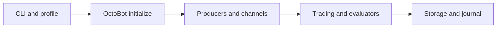
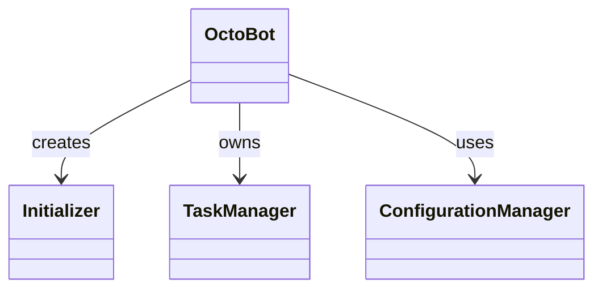
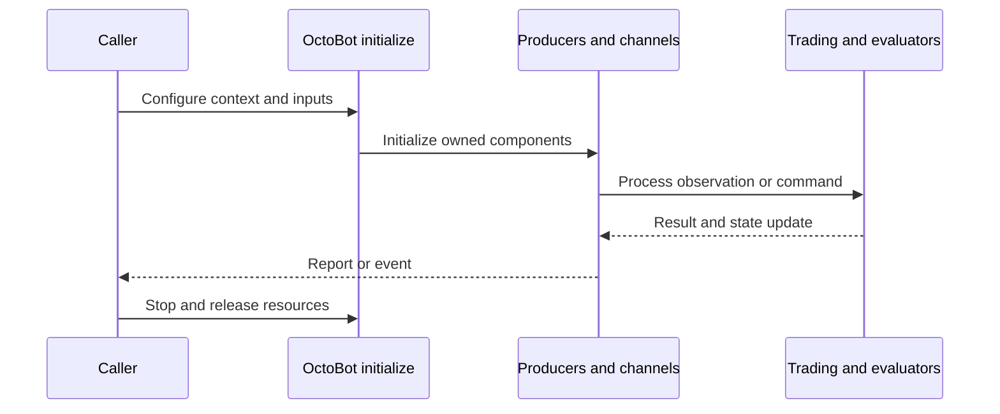
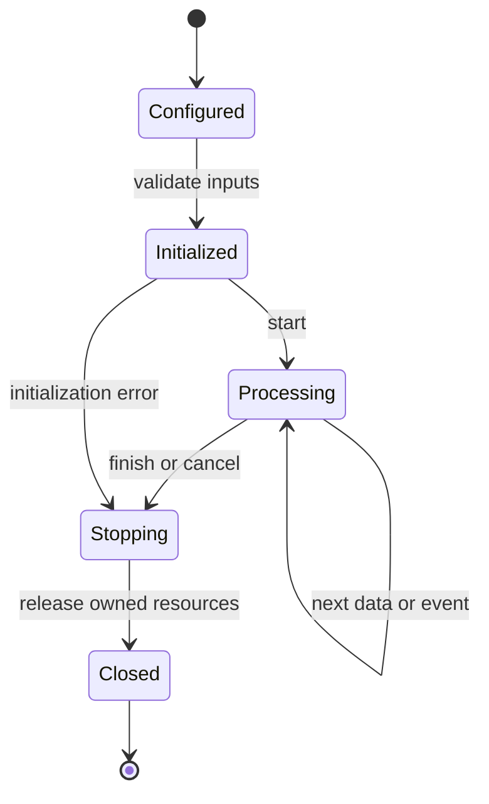
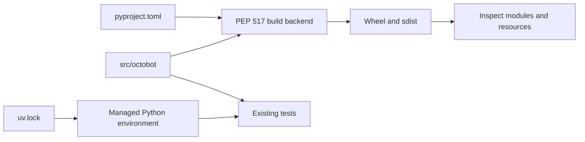
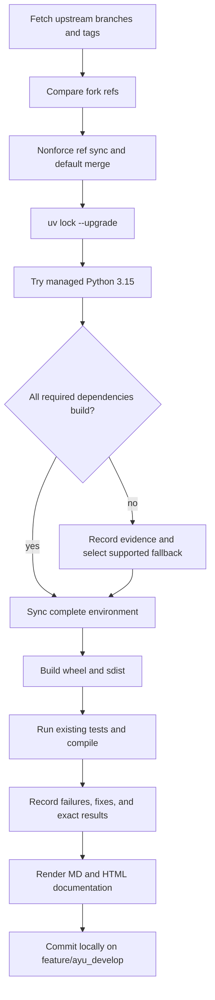

# OctoBot: architecture and development

OctoBot orchestrates exchange connections, evaluator signals, trading modes, service interfaces, backtesting, and community synchronization. The upstream default is now a monorepo: reusable libraries live under packages while this fork retains the core application under src/octobot.

## Components and boundaries

The application coordinates asynchronous producers rather than embedding exchange or indicator implementations in the launcher. Initializer creates storage and the runtime; TaskManager owns asynchronous work; ConfigurationManager tracks original and edited configuration. Exchange, evaluator, and service producers attach their own channel consumers. The community node journal records account changes and publishes through the synchronization layer. Packages contain independent APIs, and tentacles supply discoverable plugins and their configuration/resources.

The following class view names implementation classes. Cross-package types are supplied by the host ecosystem; arrows describe inheritance or usage, not copied ownership.

## Runtime workflow

CLI loads and validates a profile, creates OctoBot, initializes storage and producers, starts asynchronous channels, and waits for work. Exchange events reach evaluators and trading modes; resulting orders and portfolio updates flow back through trading channels. Shutdown stops producers and closes owned sessions. Tentacle export builds plugin assets before assembling an archive; installation generates the root tentacles namespace.

This sequence is an architectural view of responsibility and resource ownership. Individual plugin, connector, and strategy implementations can add asynchronous events and error branches. The lifecycle below is a conceptual operating workflow, rather than a claim that every component has one shared state enum.

## Features and extension points

Live and simulated trading; independent backtests and strategy optimization; profile editing and synchronization; node journal recording and replay; service feeds and web/API interfaces; typed Python and TypeScript client packages.

Extend the owning component behind its existing public interface. Keep metadata and configuration alongside plugin/strategy resources. Exchange-specific behavior belongs in an adapter; strategy decisions belong in the strategy/evaluator layer; persistence schema and migrations belong with the storage implementation. Review the source map below before changing a boundary, and exercise the existing tests associated with that boundary.

## Packaging and dependency design

The root wheel includes the Python namespaces from packages. packages/tentacles is plugin source; the installed root tentacles directory is generated output and must stay out of commits. Python 3.15 is limited by the available OctoBot-Tulipy binary distribution; Python 3.14.8 is the current complete dependency target. Required Starfish 3 prereleases remain explicit because the stable 2 series lacks upstream APIs.

The lock records exact package versions, hashes, platform markers, and local source mappings. Path sources deliberately bind related repositories in this workspace; clone sibling repositories at the documented names before synchronization. Published packaging metadata describes public dependencies, while uv source settings select this development workspace. Resolve dependency changes with uv lock --upgrade and retain the generated lock, then verify the same locked environment.

## Maintenance workflow

All upstream branches and tags are fetched. Fork updates use nonforce pushes; a divergent branch is merged without erasing fork history. The default branch is merged into feature/ayu_develop with package/resource conflicts reconciled in their installed locations. Build and test evidence is recorded before a local maintenance commit. Feature branch publication is a separate root-level action.

No existing test assertions are removed and no new test cases are introduced in this maintenance pass. Corrected fixtures preserve coverage while making paths, corruption inputs, and resource cleanup compatible with the selected interpreter. A failed test or unsupported dependency is reported explicitly in [validation](validation.md); package build success does not imply strategy correctness, profitability, or successful live connectivity.

## Source map

| Source | Responsibility and location |
| --- | --- |
| [cli.py](../src/octobot/cli.py) | src/octobot/cli.py |
| [octobot.py](../src/octobot/octobot.py) | src/octobot/octobot.py |
| [initializer.py](../src/octobot/initializer.py) | src/octobot/initializer.py |
| [task_manager.py](../src/octobot/task_manager.py) | src/octobot/task_manager.py |
| [configuration_manager.py](../src/octobot/configuration_manager.py) | src/octobot/configuration_manager.py |
| [exchange_producer.py](../src/octobot/producers/exchange_producer.py) | src/octobot/producers/exchange_producer.py |
| [evaluator_producer.py](../src/octobot/producers/evaluator_producer.py) | src/octobot/producers/evaluator_producer.py |
| [octobot_channel.py](../src/octobot/channels/octobot_channel.py) | src/octobot/channels/octobot_channel.py |
| [accounts.py](../src/octobot/community/node_journal/recording/accounts.py) | src/octobot/community/node_journal/recording/accounts.py |
| [pyproject.toml](../pyproject.toml) | pyproject.toml |
| [uv.lock](../uv.lock) | uv.lock |
| [README.md](../README.md) | README.md |
| [conftest.py](../tests/conftest.py) | tests/conftest.py |

## Further reading

Use [development.md](development.md) for reproducible commands and [validation.md](validation.md) for exact interpreter, dependency, build, test, and blocker evidence. The equivalent [HTML architecture document](ayu-develop.html) supports browsing and rendered diagrams.
