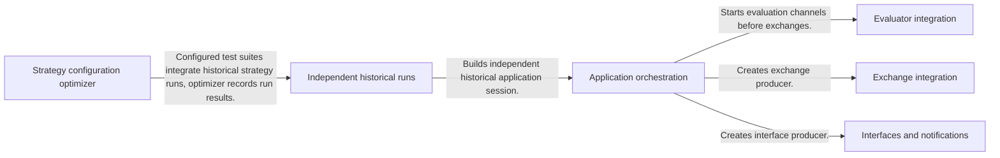
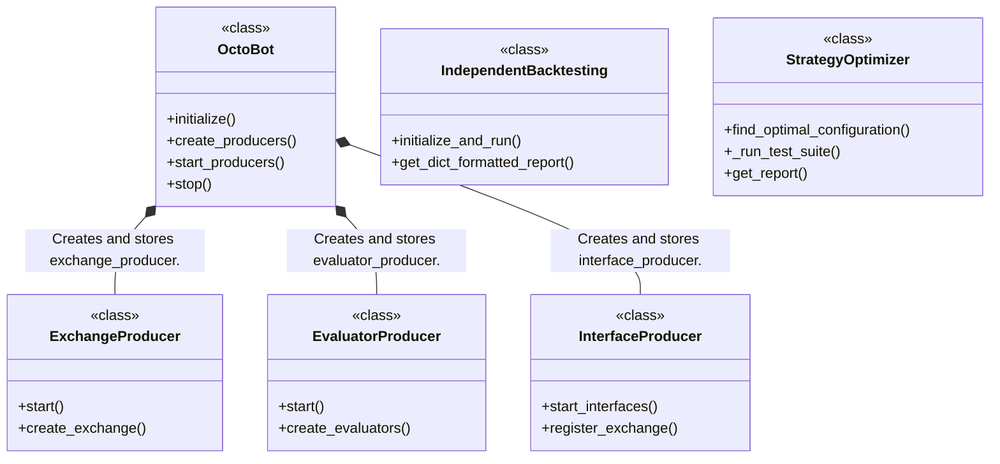
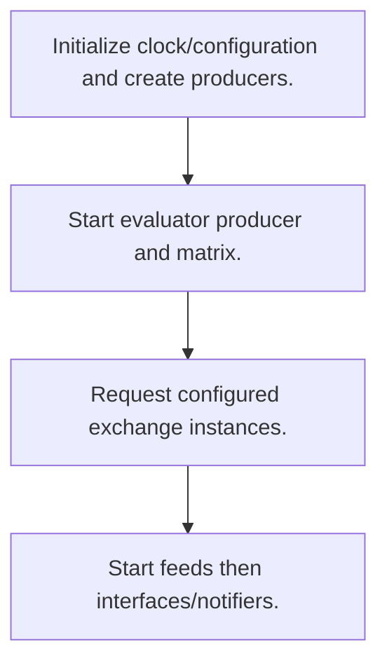
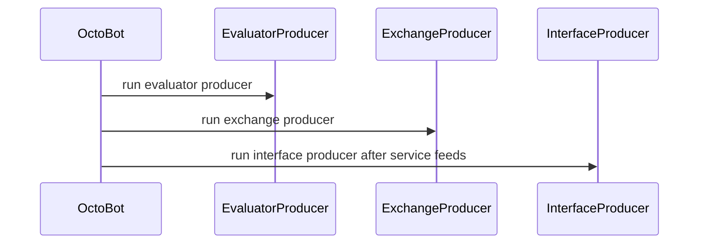

# OctoBot: workflow, design and architecture

Updated: **2026-10-13**
Reviewed Git hash: `5cc86ef09d81da82a1227d590ba4ec7d374c0fa2`
Branch: `feature/ayu_develop`
Source diff SHA256: `e3b0c44298fc1c149afbf4c8996fb92427ae41e4649b934ca495991b7852b855`
Scope: **Trading application / plugin host** / Maintenance: **active**
Languages: Python

[HTML edition](ayu-develop.html) / [Development](development.md) / [Historical validation](validation.md) / [Full system comparison](../../docs/index.html)

## Purpose and scope

Configure and orchestrate crypto exchange managers, evaluator matrices, service feeds and interfaces; coordinate independent historical simulations.

## Features and support boundaries

Native = implemented here. Integration = supplied through a named host/API. Limited = material restriction. Not provided = evidenced scope exclusion. Unverified = support/absence not established. Not applicable = outside this artifact type.

| Capability | Status | Implementation and limits | Source |
|---|---|---|---|
| Backtesting | Integration | IndependentBacktesting coordinates backtesting/trading packages and returns reports. | [IndependentBacktesting.initialize_and_run](../src/octobot/backtesting/independent_backtesting.py) ([L108](https://github.com/alexcwyu/OctoBot/blob/5cc86ef09d81da82a1227d590ba4ec7d374c0fa2/src/octobot/backtesting/independent_backtesting.py#L108)) / [IndependentBacktesting.get_dict_formatted_report](../src/octobot/backtesting/independent_backtesting.py) ([L258](https://github.com/alexcwyu/OctoBot/blob/5cc86ef09d81da82a1227d590ba4ec7d374c0fa2/src/octobot/backtesting/independent_backtesting.py#L258)) |
| Live execution | Integration | Delegated to OctoBot-Trading exchange managers and installed trading-mode/connectors; no live execution was exercised. | [ExchangeProducer.create_exchange](../src/octobot/producers/exchange_producer.py) ([L86](https://github.com/alexcwyu/OctoBot/blob/5cc86ef09d81da82a1227d590ba4ec7d374c0fa2/src/octobot/producers/exchange_producer.py#L86)) |
| Paper trading | Integration | Trading package simulator provides paper mode in host-created exchange managers; application producer only coordinates construction. | [ExchangeProducer.create_exchange](../src/octobot/producers/exchange_producer.py) ([L86](https://github.com/alexcwyu/OctoBot/blob/5cc86ef09d81da82a1227d590ba4ec7d374c0fa2/src/octobot/producers/exchange_producer.py#L86)) |
| Event driven | Native | Application owns producer/channel orchestration and plugin lifecycle. | [OctoBot.initialize](../src/octobot/octobot.py) ([L121](https://github.com/alexcwyu/OctoBot/blob/5cc86ef09d81da82a1227d590ba4ec7d374c0fa2/src/octobot/octobot.py#L121)) / [OctoBot.create_producers](../src/octobot/octobot.py) ([L134](https://github.com/alexcwyu/OctoBot/blob/5cc86ef09d81da82a1227d590ba4ec7d374c0fa2/src/octobot/octobot.py#L134)) |
| Vectorized | Unverified | Representative source review did not establish this capability; no claim of absence. | Not applicable to this repository scope. |
| Order management | Integration | Delegated to OctoBot-Trading exchange managers and installed trading-mode/connectors; no live execution was exercised. | [ExchangeProducer.create_exchange](../src/octobot/producers/exchange_producer.py) ([L86](https://github.com/alexcwyu/OctoBot/blob/5cc86ef09d81da82a1227d590ba4ec7d374c0fa2/src/octobot/producers/exchange_producer.py#L86)) |
| Order types | Integration | Delegated to OctoBot-Trading exchange managers and installed trading-mode/connectors; no live execution was exercised. | [ExchangeProducer.create_exchange](../src/octobot/producers/exchange_producer.py) ([L86](https://github.com/alexcwyu/OctoBot/blob/5cc86ef09d81da82a1227d590ba4ec7d374c0fa2/src/octobot/producers/exchange_producer.py#L86)) |
| Multi venue | Integration | Delegated to OctoBot-Trading exchange managers and installed trading-mode/connectors; no live execution was exercised. | [ExchangeProducer.create_exchange](../src/octobot/producers/exchange_producer.py) ([L86](https://github.com/alexcwyu/OctoBot/blob/5cc86ef09d81da82a1227d590ba4ec7d374c0fa2/src/octobot/producers/exchange_producer.py#L86)) |
| Crypto | Integration | Delegated to OctoBot-Trading exchange managers and installed trading-mode/connectors; no live execution was exercised. | [ExchangeProducer.create_exchange](../src/octobot/producers/exchange_producer.py) ([L86](https://github.com/alexcwyu/OctoBot/blob/5cc86ef09d81da82a1227d590ba4ec7d374c0fa2/src/octobot/producers/exchange_producer.py#L86)) |
| Equities | Unverified | Representative source review did not establish this capability; no claim of absence. | Not applicable to this repository scope. |
| Futures | Unverified | Representative source review did not establish this capability; no claim of absence. | Not applicable to this repository scope. |
| Options | Unverified | Representative source review did not establish this capability; no claim of absence. | Not applicable to this repository scope. |
| Forex | Unverified | Representative source review did not establish this capability; no claim of absence. | Not applicable to this repository scope. |
| Strategy api | Integration | Evaluator and trading-mode tentacles supply strategy implementations. | [EvaluatorProducer.start](../src/octobot/producers/evaluator_producer.py) ([L40](https://github.com/alexcwyu/OctoBot/blob/5cc86ef09d81da82a1227d590ba4ec7d374c0fa2/src/octobot/producers/evaluator_producer.py#L40)) / [ExchangeProducer.create_exchange](../src/octobot/producers/exchange_producer.py) ([L86](https://github.com/alexcwyu/OctoBot/blob/5cc86ef09d81da82a1227d590ba4ec7d374c0fa2/src/octobot/producers/exchange_producer.py#L86)) |
| Optimization | Native | Local optimizer enumerates evaluator/timeframe/risk combinations and coordinates test suites; historical execution still uses host backtesting/trading packages. | [StrategyOptimizer.find_optimal_configuration](../src/octobot/strategy_optimizer/strategy_optimizer.py) ([L87](https://github.com/alexcwyu/OctoBot/blob/5cc86ef09d81da82a1227d590ba4ec7d374c0fa2/src/octobot/strategy_optimizer/strategy_optimizer.py#L87)) / [StrategyOptimizer._run_test_suite](../src/octobot/strategy_optimizer/strategy_optimizer.py) ([L185](https://github.com/alexcwyu/OctoBot/blob/5cc86ef09d81da82a1227d590ba4ec7d374c0fa2/src/octobot/strategy_optimizer/strategy_optimizer.py#L185)) |
| Machine learning | Unverified | Representative source review did not establish this capability; no claim of absence. | Not applicable to this repository scope. |
| Reinforcement learning | Unverified | Representative source review did not establish this capability; no claim of absence. | Not applicable to this repository scope. |
| Portfolio | Integration | Delegated to OctoBot-Trading exchange managers and installed trading-mode/connectors; no live execution was exercised. | [ExchangeProducer.create_exchange](../src/octobot/producers/exchange_producer.py) ([L86](https://github.com/alexcwyu/OctoBot/blob/5cc86ef09d81da82a1227d590ba4ec7d374c0fa2/src/octobot/producers/exchange_producer.py#L86)) |
| Risk management | Integration | Delegated to OctoBot-Trading exchange managers and installed trading-mode/connectors; no live execution was exercised. | [ExchangeProducer.create_exchange](../src/octobot/producers/exchange_producer.py) ([L86](https://github.com/alexcwyu/OctoBot/blob/5cc86ef09d81da82a1227d590ba4ec7d374c0fa2/src/octobot/producers/exchange_producer.py#L86)) |
| Performance analytics | Integration | IndependentBacktesting coordinates backtesting/trading packages and returns reports. | [IndependentBacktesting.initialize_and_run](../src/octobot/backtesting/independent_backtesting.py) ([L108](https://github.com/alexcwyu/OctoBot/blob/5cc86ef09d81da82a1227d590ba4ec7d374c0fa2/src/octobot/backtesting/independent_backtesting.py#L108)) / [IndependentBacktesting.get_dict_formatted_report](../src/octobot/backtesting/independent_backtesting.py) ([L258](https://github.com/alexcwyu/OctoBot/blob/5cc86ef09d81da82a1227d590ba4ec7d374c0fa2/src/octobot/backtesting/independent_backtesting.py#L258)) |
| Historical data | Integration | IndependentBacktesting coordinates backtesting/trading packages and returns reports. | [IndependentBacktesting.initialize_and_run](../src/octobot/backtesting/independent_backtesting.py) ([L108](https://github.com/alexcwyu/OctoBot/blob/5cc86ef09d81da82a1227d590ba4ec7d374c0fa2/src/octobot/backtesting/independent_backtesting.py#L108)) / [IndependentBacktesting.get_dict_formatted_report](../src/octobot/backtesting/independent_backtesting.py) ([L258](https://github.com/alexcwyu/OctoBot/blob/5cc86ef09d81da82a1227d590ba4ec7d374c0fa2/src/octobot/backtesting/independent_backtesting.py#L258)) |
| Streaming data | Integration | Delegated to OctoBot-Trading exchange managers and installed trading-mode/connectors; no live execution was exercised. | [ExchangeProducer.create_exchange](../src/octobot/producers/exchange_producer.py) ([L86](https://github.com/alexcwyu/OctoBot/blob/5cc86ef09d81da82a1227d590ba4ec7d374c0fa2/src/octobot/producers/exchange_producer.py#L86)) |
| Persistence | Unverified | Representative source review did not establish this capability; no claim of absence. | Not applicable to this repository scope. |
| Data pipeline | Unverified | Representative source review did not establish this capability; no claim of absence. | Not applicable to this repository scope. |
| Web ui | Integration | Services factories instantiate installed interface/notifier tentacles. | [InterfaceProducer.start_interfaces](../src/octobot/producers/interface_producer.py) ([L50](https://github.com/alexcwyu/OctoBot/blob/5cc86ef09d81da82a1227d590ba4ec7d374c0fa2/src/octobot/producers/interface_producer.py#L50)) |
| Cli | Native | CLI parses startup arguments and starts the configured distribution. | [main](../src/octobot/cli.py) ([L858](https://github.com/alexcwyu/OctoBot/blob/5cc86ef09d81da82a1227d590ba4ec7d374c0fa2/src/octobot/cli.py#L858)) |
| Monitoring | Integration | Services factories instantiate installed interface/notifier tentacles. | [InterfaceProducer.start_interfaces](../src/octobot/producers/interface_producer.py) ([L50](https://github.com/alexcwyu/OctoBot/blob/5cc86ef09d81da82a1227d590ba4ec7d374c0fa2/src/octobot/producers/interface_producer.py#L50)) |
| Extension api | Native | Application owns producer/channel orchestration and plugin lifecycle. | [OctoBot.initialize](../src/octobot/octobot.py) ([L121](https://github.com/alexcwyu/OctoBot/blob/5cc86ef09d81da82a1227d590ba4ec7d374c0fa2/src/octobot/octobot.py#L121)) / [OctoBot.create_producers](../src/octobot/octobot.py) ([L134](https://github.com/alexcwyu/OctoBot/blob/5cc86ef09d81da82a1227d590ba4ec7d374c0fa2/src/octobot/octobot.py#L134)) |
| Native acceleration | Unverified | Representative source review did not establish this capability; no claim of absence. | Not applicable to this repository scope. |
| Distributed execution | Unverified | Representative source review did not establish this capability; no claim of absence. | Not applicable to this repository scope. |

## System components

| Component | Responsibility | Source |
|---|---|---|
| Application orchestration | Owns runtime producer lifecycle and startup ordering. | [OctoBot.initialize](../src/octobot/octobot.py) ([L121](https://github.com/alexcwyu/OctoBot/blob/5cc86ef09d81da82a1227d590ba4ec7d374c0fa2/src/octobot/octobot.py#L121)) |
| Exchange integration | Requests trading-package exchange construction and tracks IDs. | [ExchangeProducer.create_exchange](../src/octobot/producers/exchange_producer.py) ([L86](https://github.com/alexcwyu/OctoBot/blob/5cc86ef09d81da82a1227d590ba4ec7d374c0fa2/src/octobot/producers/exchange_producer.py#L86)) |
| Evaluator integration | Creates evaluation matrix and evaluator runtime. | [EvaluatorProducer.start](../src/octobot/producers/evaluator_producer.py) ([L40](https://github.com/alexcwyu/OctoBot/blob/5cc86ef09d81da82a1227d590ba4ec7d374c0fa2/src/octobot/producers/evaluator_producer.py#L40)) |
| Interfaces and notifications | Loads service interfaces/notifiers through plugins. | [InterfaceProducer.start_interfaces](../src/octobot/producers/interface_producer.py) ([L50](https://github.com/alexcwyu/OctoBot/blob/5cc86ef09d81da82a1227d590ba4ec7d374c0fa2/src/octobot/producers/interface_producer.py#L50)) |
| Independent historical runs | Constructs historical app sessions and extracts reports. | [IndependentBacktesting.initialize_and_run](../src/octobot/backtesting/independent_backtesting.py) ([L108](https://github.com/alexcwyu/OctoBot/blob/5cc86ef09d81da82a1227d590ba4ec7d374c0fa2/src/octobot/backtesting/independent_backtesting.py#L108)) |
| Strategy configuration optimizer | Enumerate technical evaluator/timeframe/risk combinations and collect StrategyTestSuite outcomes. | [StrategyOptimizer.find_optimal_configuration](../src/octobot/strategy_optimizer/strategy_optimizer.py) ([L87](https://github.com/alexcwyu/OctoBot/blob/5cc86ef09d81da82a1227d590ba4ec7d374c0fa2/src/octobot/strategy_optimizer/strategy_optimizer.py#L87)) / [StrategyOptimizer._run_test_suite](../src/octobot/strategy_optimizer/strategy_optimizer.py) ([L185](https://github.com/alexcwyu/OctoBot/blob/5cc86ef09d81da82a1227d590ba4ec7d374c0fa2/src/octobot/strategy_optimizer/strategy_optimizer.py#L185)) |

## Architecture and component boundaries

The component view summarizes inspected responsibility boundaries. Arrows identify the documented API/data dependencies; this is not a deployment-readiness claim.

- Starts evaluation channels before exchanges.: [OctoBot.start_producers](../src/octobot/octobot.py) ([L144](https://github.com/alexcwyu/OctoBot/blob/5cc86ef09d81da82a1227d590ba4ec7d374c0fa2/src/octobot/octobot.py#L144))
- Creates exchange producer.: [OctoBot.create_producers](../src/octobot/octobot.py) ([L134](https://github.com/alexcwyu/OctoBot/blob/5cc86ef09d81da82a1227d590ba4ec7d374c0fa2/src/octobot/octobot.py#L134))
- Creates interface producer.: [OctoBot.create_producers](../src/octobot/octobot.py) ([L134](https://github.com/alexcwyu/OctoBot/blob/5cc86ef09d81da82a1227d590ba4ec7d374c0fa2/src/octobot/octobot.py#L134))
- Builds independent historical application session.: [IndependentBacktesting.initialize_and_run](../src/octobot/backtesting/independent_backtesting.py) ([L108](https://github.com/alexcwyu/OctoBot/blob/5cc86ef09d81da82a1227d590ba4ec7d374c0fa2/src/octobot/backtesting/independent_backtesting.py#L108))
- Configured test suites integrate historical strategy runs; optimizer records run results.: [StrategyOptimizer._run_test_suite](../src/octobot/strategy_optimizer/strategy_optimizer.py) ([L185](https://github.com/alexcwyu/OctoBot/blob/5cc86ef09d81da82a1227d590ba4ec7d374c0fa2/src/octobot/strategy_optimizer/strategy_optimizer.py#L185)) / [StrategyTestSuite._run_backtesting_with_current_config](../src/octobot/strategy_optimizer/strategy_test_suite.py) ([L112](https://github.com/alexcwyu/OctoBot/blob/5cc86ef09d81da82a1227d590ba4ec7d374c0fa2/src/octobot/strategy_optimizer/strategy_test_suite.py#L112))

## Design decisions

| Decision | Rationale | Tradeoff | Evidence |
|---|---|---|---|
| Initialize evaluators before exchange/service producers. | Evaluator subscriptions and feed requirements must exist before feeds run. | Startup relies on ordered asynchronous package lifecycle. | [OctoBot.start_producers](../src/octobot/octobot.py) ([L144](https://github.com/alexcwyu/OctoBot/blob/5cc86ef09d81da82a1227d590ba4ec7d374c0fa2/src/octobot/octobot.py#L144)) |
| Enumerate evaluator/timeframe/risk configuration combinations. | Compare configuration outcomes under copied strategy test-suite settings. | Search size grows with technical evaluator and timeframe combinations; configuration optimizer is not a universal ML or distributed optimization platform. | [StrategyOptimizer.find_optimal_configuration](../src/octobot/strategy_optimizer/strategy_optimizer.py) ([L87](https://github.com/alexcwyu/OctoBot/blob/5cc86ef09d81da82a1227d590ba4ec7d374c0fa2/src/octobot/strategy_optimizer/strategy_optimizer.py#L87)) / [StrategyOptimizer._run_test_suite](../src/octobot/strategy_optimizer/strategy_optimizer.py) ([L185](https://github.com/alexcwyu/OctoBot/blob/5cc86ef09d81da82a1227d590ba4ec7d374c0fa2/src/octobot/strategy_optimizer/strategy_optimizer.py#L185)) |

## Class and interface relationships

Each node is a reviewed source symbol. Function/module nodes are explicitly labeled; they do not imply Python classes. Only reviewed relationships are drawn.

- **OctoBot** (class): [OctoBot.initialize](../src/octobot/octobot.py) ([L121](https://github.com/alexcwyu/OctoBot/blob/5cc86ef09d81da82a1227d590ba4ec7d374c0fa2/src/octobot/octobot.py#L121))
- **ExchangeProducer** (class): [ExchangeProducer.create_exchange](../src/octobot/producers/exchange_producer.py) ([L86](https://github.com/alexcwyu/OctoBot/blob/5cc86ef09d81da82a1227d590ba4ec7d374c0fa2/src/octobot/producers/exchange_producer.py#L86))
- **EvaluatorProducer** (class): [EvaluatorProducer.start](../src/octobot/producers/evaluator_producer.py) ([L40](https://github.com/alexcwyu/OctoBot/blob/5cc86ef09d81da82a1227d590ba4ec7d374c0fa2/src/octobot/producers/evaluator_producer.py#L40))
- **InterfaceProducer** (class): [InterfaceProducer.start_interfaces](../src/octobot/producers/interface_producer.py) ([L50](https://github.com/alexcwyu/OctoBot/blob/5cc86ef09d81da82a1227d590ba4ec7d374c0fa2/src/octobot/producers/interface_producer.py#L50))
- **IndependentBacktesting** (class): [IndependentBacktesting.initialize_and_run](../src/octobot/backtesting/independent_backtesting.py) ([L108](https://github.com/alexcwyu/OctoBot/blob/5cc86ef09d81da82a1227d590ba4ec7d374c0fa2/src/octobot/backtesting/independent_backtesting.py#L108))
- **StrategyOptimizer** (class): [StrategyOptimizer.find_optimal_configuration](../src/octobot/strategy_optimizer/strategy_optimizer.py) ([L87](https://github.com/alexcwyu/OctoBot/blob/5cc86ef09d81da82a1227d590ba4ec7d374c0fa2/src/octobot/strategy_optimizer/strategy_optimizer.py#L87)) / [StrategyOptimizer._run_test_suite](../src/octobot/strategy_optimizer/strategy_optimizer.py) ([L185](https://github.com/alexcwyu/OctoBot/blob/5cc86ef09d81da82a1227d590ba4ec7d374c0fa2/src/octobot/strategy_optimizer/strategy_optimizer.py#L185))

## Workflow

### Configured bot startup

Concrete startup flow; downstream trading, evaluators and UI behavior belongs to host packages/tentacles.

1. Initialize clock/configuration and create producers.. [OctoBot.initialize](../src/octobot/octobot.py) ([L121](https://github.com/alexcwyu/OctoBot/blob/5cc86ef09d81da82a1227d590ba4ec7d374c0fa2/src/octobot/octobot.py#L121)) / [OctoBot.create_producers](../src/octobot/octobot.py) ([L134](https://github.com/alexcwyu/OctoBot/blob/5cc86ef09d81da82a1227d590ba4ec7d374c0fa2/src/octobot/octobot.py#L134))
2. Start evaluator producer and matrix.. [OctoBot.start_producers](../src/octobot/octobot.py) ([L144](https://github.com/alexcwyu/OctoBot/blob/5cc86ef09d81da82a1227d590ba4ec7d374c0fa2/src/octobot/octobot.py#L144)) / [EvaluatorProducer.start](../src/octobot/producers/evaluator_producer.py) ([L40](https://github.com/alexcwyu/OctoBot/blob/5cc86ef09d81da82a1227d590ba4ec7d374c0fa2/src/octobot/producers/evaluator_producer.py#L40))
3. Request configured exchange instances.. [OctoBot.start_producers](../src/octobot/octobot.py) ([L144](https://github.com/alexcwyu/OctoBot/blob/5cc86ef09d81da82a1227d590ba4ec7d374c0fa2/src/octobot/octobot.py#L144)) / [ExchangeProducer.create_exchange](../src/octobot/producers/exchange_producer.py) ([L86](https://github.com/alexcwyu/OctoBot/blob/5cc86ef09d81da82a1227d590ba4ec7d374c0fa2/src/octobot/producers/exchange_producer.py#L86))
4. Start feeds then interfaces/notifiers.. [OctoBot.start_producers](../src/octobot/octobot.py) ([L144](https://github.com/alexcwyu/OctoBot/blob/5cc86ef09d81da82a1227d590ba4ec7d374c0fa2/src/octobot/octobot.py#L144)) / [InterfaceProducer.start_interfaces](../src/octobot/producers/interface_producer.py) ([L50](https://github.com/alexcwyu/OctoBot/blob/5cc86ef09d81da82a1227d590ba4ec7d374c0fa2/src/octobot/producers/interface_producer.py#L50))

## Sequence

Producer initialization

- run evaluator producer: [OctoBot.start_producers](../src/octobot/octobot.py) ([L144](https://github.com/alexcwyu/OctoBot/blob/5cc86ef09d81da82a1227d590ba4ec7d374c0fa2/src/octobot/octobot.py#L144))
- run exchange producer: [OctoBot.start_producers](../src/octobot/octobot.py) ([L144](https://github.com/alexcwyu/OctoBot/blob/5cc86ef09d81da82a1227d590ba4ec7d374c0fa2/src/octobot/octobot.py#L144))
- run interface producer after service feeds: [OctoBot.start_producers](../src/octobot/octobot.py) ([L144](https://github.com/alexcwyu/OctoBot/blob/5cc86ef09d81da82a1227d590ba4ec7d374c0fa2/src/octobot/octobot.py#L144))

## Strengths and limits

### Strengths

- Explicit evaluator → exchange → feed → interface startup order records actual runtime dependencies. [OctoBot.start_producers](../src/octobot/octobot.py) ([L144](https://github.com/alexcwyu/OctoBot/blob/5cc86ef09d81da82a1227d590ba4ec7d374c0fa2/src/octobot/octobot.py#L144))

### Limitations

- A host install and activated tentacles determine exchange, strategy and UI availability. [ExchangeProducer.create_exchange](../src/octobot/producers/exchange_producer.py) ([L86](https://github.com/alexcwyu/OctoBot/blob/5cc86ef09d81da82a1227d590ba4ec7d374c0fa2/src/octobot/producers/exchange_producer.py#L86)) / [InterfaceProducer.start_interfaces](../src/octobot/producers/interface_producer.py) ([L50](https://github.com/alexcwyu/OctoBot/blob/5cc86ef09d81da82a1227d590ba4ec7d374c0fa2/src/octobot/producers/interface_producer.py#L50))

## Validation scope

The linked validation and command records preserve actual historical runs and user-authorized exclusions. This source/document review does not rerun application tests, establish live trading readiness or rank benchmark performance. Current data, credential and runtime prerequisites remain material.

[Repository validation](validation.md) / [Executed checks](maintenance/index.md)

## Source map

| Reviewed symbol/path | Inspected responsibility | Actual file SHA256 |
|---|---|---|
| [OctoBot.initialize](../src/octobot/octobot.py) ([L121](https://github.com/alexcwyu/OctoBot/blob/5cc86ef09d81da82a1227d590ba4ec7d374c0fa2/src/octobot/octobot.py#L121)) | Initializes the clock, initializer and tools, creates producers, starts them, then performs post-initialization. | `2c46f972d1d94412bbaf9028dbccd2f4a37dcd51de22537ee19f39f4514d5791` |
| [OctoBot.start_producers](../src/octobot/octobot.py) ([L144](https://github.com/alexcwyu/OctoBot/blob/5cc86ef09d81da82a1227d590ba4ec7d374c0fa2/src/octobot/octobot.py#L144)) | Runs evaluator producer before exchange producer; starts service feeds after evaluator requirements, then interfaces. | `2c46f972d1d94412bbaf9028dbccd2f4a37dcd51de22537ee19f39f4514d5791` |
| [OctoBot.create_producers](../src/octobot/octobot.py) ([L134](https://github.com/alexcwyu/OctoBot/blob/5cc86ef09d81da82a1227d590ba4ec7d374c0fa2/src/octobot/octobot.py#L134)) | Instantiates ExchangeProducer, EvaluatorProducer, InterfaceProducer and ServiceFeedProducer owned by the bot. | `2c46f972d1d94412bbaf9028dbccd2f4a37dcd51de22537ee19f39f4514d5791` |
| [ExchangeProducer.create_exchange](../src/octobot/producers/exchange_producer.py) ([L86](https://github.com/alexcwyu/OctoBot/blob/5cc86ef09d81da82a1227d590ba4ec7d374c0fa2/src/octobot/producers/exchange_producer.py#L86)) | Sends exchange creation requests with tentacles config and backtesting context. | `23ef7d072457ccb47b3e4d93184ecdbeec3b6e64fd9c9cffac52e337bbb9eb04` |
| [EvaluatorProducer.start](../src/octobot/producers/evaluator_producer.py) ([L40](https://github.com/alexcwyu/OctoBot/blob/5cc86ef09d81da82a1227d590ba4ec7d374c0fa2/src/octobot/producers/evaluator_producer.py#L40)) | Initializes evaluator channels and sends matrix creation request. | `fbaa606cd5cfe8b784aebc5759fcb39861e04f851fd9f8bef2e5c4bc27cf9e2b` |
| [InterfaceProducer.start_interfaces](../src/octobot/producers/interface_producer.py) ([L50](https://github.com/alexcwyu/OctoBot/blob/5cc86ef09d81da82a1227d590ba4ec7d374c0fa2/src/octobot/producers/interface_producer.py#L50)) | Builds interfaces and notifiers via services factories; registers existing exchanges. | `1e51a97df75b65203a0ee6a0c5681e1a17249e3b7cfcd2f863dbb0a7c8552e59` |
| [IndependentBacktesting.initialize_and_run](../src/octobot/backtesting/independent_backtesting.py) ([L108](https://github.com/alexcwyu/OctoBot/blob/5cc86ef09d81da82a1227d590ba4ec7d374c0fa2/src/octobot/backtesting/independent_backtesting.py#L108)) | Initializes independent config and factory, adapts imported data, starts historical bot. | `a95e59482bce0296e99eb9d6d87e52e3c9593b88b48452c7d178ae9f72ea20fd` |
| [IndependentBacktesting.get_dict_formatted_report](../src/octobot/backtesting/independent_backtesting.py) ([L258](https://github.com/alexcwyu/OctoBot/blob/5cc86ef09d81da82a1227d590ba4ec7d374c0fa2/src/octobot/backtesting/independent_backtesting.py#L258)) | Returns profitability, market and trading reports collected from exchange managers. | `a95e59482bce0296e99eb9d6d87e52e3c9593b88b48452c7d178ae9f72ea20fd` |
| [main](../src/octobot/cli.py) ([L858](https://github.com/alexcwyu/OctoBot/blob/5cc86ef09d81da82a1227d590ba4ec7d374c0fa2/src/octobot/cli.py#L858)) | CLI argument parsing and startup dispatch to app/distribution modes. | `85a844ceaf06881a8376e4c1dcc3ca06dfe4415c9a39c25f6059e8a8f89b4879` |
| [StrategyOptimizer.find_optimal_configuration](../src/octobot/strategy_optimizer/strategy_optimizer.py) ([L87](https://github.com/alexcwyu/OctoBot/blob/5cc86ef09d81da82a1227d590ba4ec7d374c0fa2/src/octobot/strategy_optimizer/strategy_optimizer.py#L87)) | Enumerates configured technical evaluator/timeframe/risk combinations, prevents simultaneous starts, runs suites and ranks results; restores logging state in finally. | `5c2b937e48dd44f50421f9122721b26031af67ab1a4d0ab74d78e1edc572ecb4` |
| [StrategyOptimizer._run_test_suite](../src/octobot/strategy_optimizer/strategy_optimizer.py) ([L185](https://github.com/alexcwyu/OctoBot/blob/5cc86ef09d81da82a1227d590ba4ec7d374c0fa2/src/octobot/strategy_optimizer/strategy_optimizer.py#L185)) | Constructs StrategyTestSuite with copied config/evaluators, runs async suite, records errors and appends results. | `5c2b937e48dd44f50421f9122721b26031af67ab1a4d0ab74d78e1edc572ecb4` |
| [StrategyTestSuite._run_backtesting_with_current_config](../src/octobot/strategy_optimizer/strategy_test_suite.py) ([L112](https://github.com/alexcwyu/OctoBot/blob/5cc86ef09d81da82a1227d590ba4ec7d374c0fa2/src/octobot/strategy_optimizer/strategy_test_suite.py#L112)) | Creates independent backtest with copied configuration and data file, initializes/runs then joins replay; storage disabled for test suite. | `35cdfb64890b8060a0a1d132eccee211a0f4a8a8fe65ce5f9606713bed83d01d` |

## Documentation provenance

Review date: 2026-10-13. Full committed source HEAD: `5cc86ef09d81da82a1227d590ba4ec7d374c0fa2`. Template version: 2. 8 source files were independently hashed for this guide.

[Evidence catalog](../../docs/systems-2026-10-13/catalog.json) / [Standard template](../../docs/guidelines/APP_TEMPLATE.md)

- Read-only source audit of inventory HEAD 5cc86ef09d81da82a1227d590ba4ec7d374c0fa2; no runtime execution, credential check or live-production assertion. Existing validation records remain separate historical evidence.
- Inspected implementation/configuration coverage: src/octobot/octobot.py, src/octobot/producers/exchange_producer.py, src/octobot/producers/evaluator_producer.py, src/octobot/producers/interface_producer.py, src/octobot/backtesting/independent_backtesting.py, src/octobot/cli.py
- Source symbols and call chains are representative coverage, not exhaustive connector, strategy or product certification. Integration statuses identify dependencies that supply the runtime behavior.
- Additional inspected coverage: src/octobot/strategy_optimizer/strategy_optimizer.py combination enumeration and copied StrategyTestSuite configuration execution.
- Optimizer-to-replay boundary verified in src/octobot/strategy_optimizer/strategy_test_suite.py:112; test suite creates and joins IndependentBacktesting.
